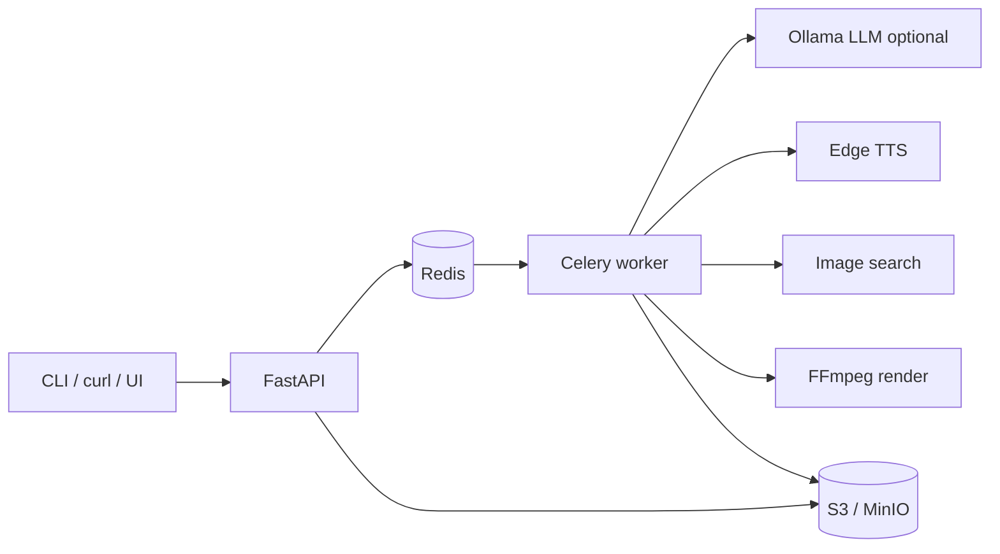

# Grandma's Storytime

Create **English kids Shorts**: you send a story idea (prompt) → the worker writes a grandma-style script, speaks it with a **warm narrator voice** (Edge TTS), and renders a **colorful vertical video** you can upload to YouTube.

**What you get today:** ~**60 s** vertical Short (**5 s** channel intro + **4** image scenes); **Ollama** (open-source LLM) or rules-only script; grandma **Edge TTS**; per-scene **stock images** (Wikimedia / Pexels / Pixabay), Ken Burns zoom, captions.

**Docs:** [Usage](docs/USAGE.md) · **[Implementation](docs/IMPLEMENTATION.md)** · [Deploy](docs/deploy/README.md) · [Ollama](docs/deploy/ollama.md)

**You are responsible** for image licenses and YouTube attribution. **Not yet:** 3D animation, Sanskrit chanting, BGM, 16:9 landscape.

## Architecture (Phase 1 — single VM / Compose)



| Layer | This repo |
|--------|-----------|
| Orchestration | `services/api` — job lifecycle, OpenAPI |
| Queue | Redis + Celery |
| Script | `script.py` + **Ollama** (`SCRIPT_PROVIDER=ollama`) or `stub` fallback |
| TTS | `worker/app/pipeline/tts.py` — **Edge TTS** (`TTS_VOICE`, default `en-GB-SoniaNeural`) |
| Render | `worker/app/pipeline/render.py` — FFmpeg + `kids_moral_v1` |
| Storage | MinIO (local) or **AWS S3** via EC2 IAM role; artifacts at `jobs/{id}/v1/output.mp4` |
| Contract | `schemas/job_request_v1.json`, `schemas/script_v1.json` |

**Job statuses:** `queued` → `scripting` → `tts` → `images` → `rendering` → `uploading` → `done` (or `failed`).

**Idempotency:** same `prompt` + `template_id` + `duration_target_sec` + `script_provider` → SHA-256 key; completed jobs return `cached: true`.

## API (v1)

| Method | Path | Description |
|--------|------|-------------|
| `POST` | `/jobs` | **Prompt only** (plain text body) → `202` with `id` |
| `POST` | `/jobs/json` | Optional JSON for advanced fields |
| `GET` | `/jobs/{id}` | Status; includes presigned `download_url` when `done` |
| `GET` | `/artifacts/{id}` | Artifact metadata + download URL (`artifact_id` = `job_id` for now) |
| `GET` | `/health` | Liveness |
| `GET` | `/docs` | OpenAPI UI (Swagger) |

**Create videos (UI, curl, PowerShell):** [docs/USAGE.md](docs/USAGE.md)

```powershell
copy .env.example .env
docker compose --profile minio up --build
```

## Local layout

```
schemas/           Versioned JSON contracts
templates/         kids_moral_v1 manifest (1080x1920)
packages/          Shared models, Redis store, S3 client
services/api/      FastAPI
services/worker/   Celery + pipeline
docker-compose.yml api, worker, redis, minio
```

## Deploy to a cloud VM (generic VPS / AWS / GCP / Azure)

**Deployment guides:** [docs/deploy/README.md](docs/deploy/README.md) — start with [Ubuntu VM + Docker](docs/deploy/ubuntu-docker-vm.md) (EC2, Hetzner, DO, etc.)

Short version:

1. Provision **one VM** (2–4 vCPU, 8 GB RAM), install Docker + Compose plugin.
2. On EC2: `cp .env.aws.example .env`, set `S3_BUCKET` / `S3_REGION`, attach [IAM role for S3](docs/deploy/aws-s3-iam-role.md). Local: `cp .env.example .env` and use `--profile minio`.
3. `docker compose up -d --build` (EC2) or `docker compose --profile minio up -d --build` (local).
4. Batch jobs; **stop the VM** when idle to save cost.

Phase 2: separate render workers (scale `worker` replicas). Phase 3: managed S3, SQS, Terraform, metrics.

## Next modules to wire (in order)

1. **Voice & music:** Indian English / prayer lines, soft BGM in FFmpeg.
2. **Visual wow:** per-scene illustrations (not only stock search) or Remotion characters.
3. **Publish adapter:** YouTube Data API after you approve each video (`draft → approved → publish`).
4. **Observability:** structured logs, job duration metrics.

**Implementation details:** [docs/IMPLEMENTATION.md](docs/IMPLEMENTATION.md)

## Stack choice

This scaffold is **Stack A** (Python, FastAPI, Celery, Redis, FFmpeg, MinIO). Stack B (Node, BullMQ, Remotion) can share the same job schemas and bucket layout.

## License

Your choice — add a LICENSE file before publishing the repo publicly.
