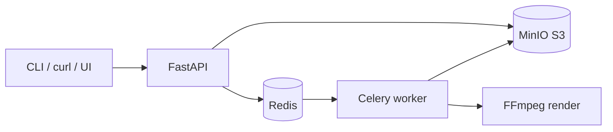

# Grandma's Storytime

Create **English kids Shorts**: you send a story idea (prompt) → the worker writes a grandma-style script, speaks it with a **warm narrator voice** (Edge TTS), and renders a **colorful vertical video** you can upload to YouTube.

**What you get today:** real spoken English, kid-friendly colors, big captions, gentle zoom/fades — good for moral stories you review before publish.

**What is not here yet:** cartoon characters, full 2D/3D animation, or automatic YouTube upload. Those are the next upgrades (illustrations per scene, Remotion, or an LLM for richer unique stories).

## Architecture (Phase 1 — single VM / Compose)



| Layer | This repo |
|--------|-----------|
| Orchestration | `services/api` — job lifecycle, OpenAPI |
| Queue | Redis + Celery |
| Script | `worker/app/pipeline/script.py` (grandma story template; LLM optional later) |
| TTS | `worker/app/pipeline/tts.py` — **Edge TTS** (`TTS_VOICE`, default `en-GB-SoniaNeural`) |
| Render | `worker/app/pipeline/render.py` — FFmpeg + `kids_moral_v1` |
| Storage | MinIO; artifacts at `jobs/{id}/v1/output.mp4` |
| Contract | `schemas/job_request_v1.json`, `schemas/script_v1.json` |

**Job statuses:** `queued` → `scripting` → `tts` → `rendering` → `uploading` → `done` (or `failed`).

**Idempotency:** same `prompt` + `template_id` + `duration_target_sec` → SHA-256 key; completed jobs return `cached: true`.

## API (v1)

| Method | Path | Description |
|--------|------|-------------|
| `POST` | `/jobs` | Enqueue render; returns `202` body with `id`, `status` |
| `GET` | `/jobs/{id}` | Status; includes presigned `download_url` when `done` |
| `GET` | `/artifacts/{id}` | Artifact metadata + download URL (`artifact_id` = `job_id` for now) |
| `GET` | `/health` | Liveness |
| `GET` | `/docs` | OpenAPI UI |

### Example

```powershell
copy .env.example .env
docker compose up --build

$job = Invoke-RestMethod -Method Post -Uri http://localhost:8000/jobs `
  -ContentType application/json `
  -Body '{"prompt":"A squirrel learns to share acorns with friends.","template_id":"kids_moral_v1"}'

.\scripts\poll_job.ps1 -JobId $job.id
# When status is done, open download_url in browser
```

Or use `.\scripts\submit_job.ps1 -Prompt "Your story idea"`.

## Local layout

```
schemas/           Versioned JSON contracts
templates/         kids_moral_v1 manifest (1080x1920)
packages/          Shared models, Redis store, S3 client
services/api/      FastAPI
services/worker/   Celery + pipeline
docker-compose.yml api, worker, redis, minio
```

## Deploy to a cloud VM (generic VPS / AWS / GCP / Azure)

**Deployment guides:** [docs/deploy/README.md](docs/deploy/README.md) — start with [Ubuntu VM + Docker](docs/deploy/ubuntu-docker-vm.md) (EC2, Hetzner, DO, etc.)

Short version:

1. Provision **one VM** (2–4 vCPU, 8 GB RAM), install Docker + Compose plugin.
2. Clone repo, `cp .env.example .env`, set strong MinIO keys and restrict firewall to **22, 8000** (or put API behind Caddy/nginx + TLS).
3. `docker compose up -d --build`.
4. Batch jobs; **stop the VM** when idle to save cost.

Phase 2: separate render workers (scale `worker` replicas). Phase 3: managed S3, SQS, Terraform, metrics.

## Next modules to wire (in order)

1. **Richer stories:** LLM (`SCRIPT_PROVIDER=ollama` or API) so every prompt becomes a unique tale, not a fixed template.
2. **Visual wow:** per-scene illustrations + light motion (or Remotion characters).
3. **Publish adapter:** YouTube Data API after you approve each video (`draft → approved → publish`).
4. **Observability:** structured logs, job duration metrics.

## Stack choice

This scaffold is **Stack A** (Python, FastAPI, Celery, Redis, FFmpeg, MinIO). Stack B (Node, BullMQ, Remotion) can share the same job schemas and bucket layout.

## License

Your choice — add a LICENSE file before publishing the repo publicly.
