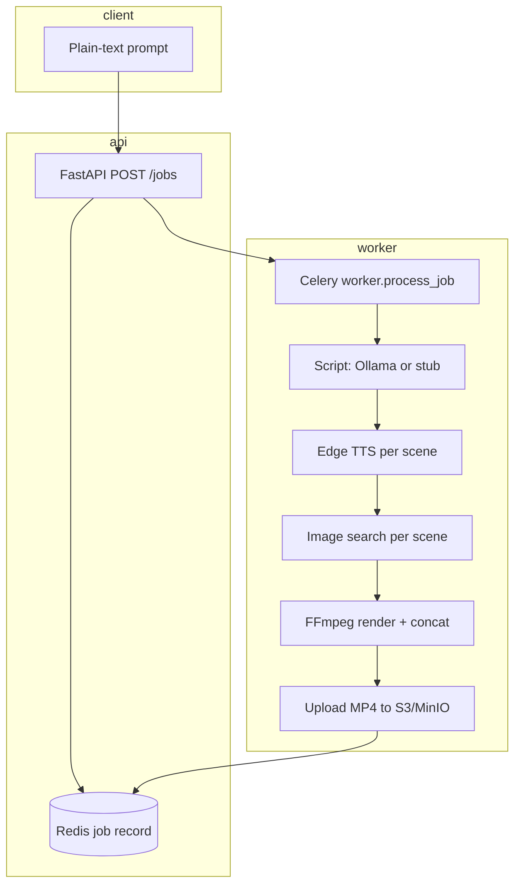

# Implementation guide

How Grandma's Storytime turns a **text prompt** into an **MP4** on a single VM (API + Celery worker + Redis + object storage).

**Related docs:** [USAGE.md](USAGE.md) (how to submit jobs) · [deploy/README.md](deploy/README.md) (VM setup) · [deploy/ollama.md](deploy/ollama.md) (LLM setup)

---

## End-to-end flow



| Step | Status | What happens |
|------|--------|----------------|
| 1 | `scripting` | Build JSON script (title, 5 scenes, durations) |
| 2 | `tts` | One WAV per scene (grandma English voice) |
| 3 | `images` | Download JPEGs (or fallback art) |
| 4 | `rendering` | FFmpeg: Ken Burns + caption card per scene, concat |
| 5 | `uploading` | `jobs/{job_id}/v1/output.mp4` + presigned URL |

Typical wall time: **~1–3 minutes** without LLM scripting; **+30–90 s** when Ollama runs on CPU.

---

## Video layout (`kids_moral_v1`)

| Output | Value |
|--------|--------|
| Resolution | **1080×1920** (vertical Shorts) |
| Target length | **`duration_target_sec`** (default **60**) |
| Structure | **5 s intro** (channel welcome, generated branding card) + **4 content scenes** with stock/generated images |

Scene timing is **fixed in the script** (`duration_sec` per scene). FFmpeg **trims or pads** audio so the total stays on schedule. Long user prompts are **not** read verbatim.

**Not implemented:** 16:9 landscape, 3D animation, background music, Sanskrit TTS, synced multi-line subtitles, exact second-by-second storyboards from the prompt.

---

## Script generation

The worker chooses a provider from **`SCRIPT_PROVIDER`** in `.env`.

| Provider | Description | When to use |
|----------|-------------|-------------|
| `stub` | Rules + keyword extraction (`prompt_extract.py`) | Fast, no extra RAM; lower quality |
| `ollama` | Local open-source LLM via [Ollama](https://ollama.com) | **Recommended** for varied prompts |
| `openai_compatible` | HTTP `POST …/v1/chat/completions` (vLLM, LocalAI, etc.) | Custom inference server |

### LLM output shape

`script_llm.py` asks the model for JSON:

- `title`, `moral`
- `scenes`: **exactly 4** objects with `caption`, `narration_line` (≤ ~22 words), `image_query` (search keywords)

`script_assemble.py` prepends the **intro** scene and sets `duration_sec` for each block.

If the LLM fails (timeout, bad JSON, Ollama down), the worker **logs a warning** and uses **`stub`** so the job can still finish.

### Code map (script)

| File | Role |
|------|------|
| `services/worker/app/pipeline/script.py` | Entry: provider dispatch + stub fallback |
| `services/worker/app/pipeline/script_llm.py` | Ollama / OpenAI-compatible chat |
| `services/worker/app/pipeline/script_assemble.py` | Intro + 4 scenes → final script JSON |
| `services/worker/app/pipeline/prompt_extract.py` | Stub-only: title, keywords (no theme hardcoding) |
| `services/worker/app/pipeline/image_queries.py` | Stub fallback image search phrases |

---

## Voice (TTS)

| Setting | Default |
|---------|---------|
| `TTS_PROVIDER` | `edge` |
| `TTS_VOICE` | `en-GB-SoniaNeural` |

`tts.py` synthesizes one clip per scene. Requires **outbound HTTPS** from the worker container to Microsoft Edge TTS.

---

## Images

| Setting | Default |
|---------|---------|
| `IMAGE_PROVIDER` | `wikimedia` |

`image_fetch.py` searches per scene using `image_query` from the script (LLM or stub). Intro scene sets `skip_image_search: true`. Temp files are deleted when the job ends.

Optional override: PNG/JPG in `templates/kids_moral_v1/assets/scene_00.png`, etc.

---

## Render

`render.py` uses **FFmpeg** (`libx264`, `veryfast` preset):

- Zoom/pan on still images (intro uses a lighter filter chain)
- Caption text via `drawtext` + `textfile=` (apostrophe-safe)
- Per-scene MP4 → concat → single output

Failures here usually show in `job.error` and `docker compose logs worker`.

---

## API and jobs

| Path | Body | Notes |
|------|------|--------|
| `POST /jobs` | `text/plain` prompt | Primary UX |
| `POST /jobs/json` | JSON `SubmitJobRequest` | `duration_target_sec`, `idempotency_key`, … |
| `GET /jobs/{id}` | — | Poll until `done`; use `download_url` |

**Idempotency:** SHA-256 of `template_id | duration_target_sec | script_provider | prompt`. Same inputs → cached completed job (`cached: true`). Change prompt or provider to force a new render.

Implementation: `packages/storytime_common/`, `services/api/app/main.py`, `services/worker/app/tasks.py`.

---

## Environment variables (pipeline)

| Variable | Default | Meaning |
|----------|---------|---------|
| `SCRIPT_PROVIDER` | `stub` | `stub` \| `ollama` \| `openai_compatible` |
| `OLLAMA_BASE_URL` | `http://ollama:11434` | Ollama API base (use `http://host.docker.internal:11434` if Ollama runs on the VM host) |
| `OLLAMA_MODEL` | `llama3.2:3b` | Model name (`ollama pull …`) |
| `LLM_OPENAI_BASE_URL` | `http://localhost:8080` | For `openai_compatible` only |
| `LLM_API_KEY` | — | Optional bearer token |
| `LLM_TIMEOUT_SEC` | `180` | Script request timeout |
| `LLM_MAX_TOKENS` | `1200` | Max generation tokens |
| `LLM_TEMPERATURE` | `0.4` | Sampling temperature |
| `TTS_PROVIDER` | `edge` | `edge` or `stub` (silent) |
| `TTS_VOICE` | `en-GB-SoniaNeural` | Edge voice id |
| `IMAGE_PROVIDER` | `wikimedia` | `wikimedia` \| `pexels` \| `pixabay` \| `none` |
| `DEFAULT_TEMPLATE_ID` | `kids_moral_v1` | Template manifest under `templates/` |

Storage variables: see [deploy/aws-s3-iam-role.md](deploy/aws-s3-iam-role.md) and `.env.example`.

---

## Docker Compose services

| Service | Purpose |
|---------|---------|
| `api` | FastAPI |
| `worker` | Celery + pipeline |
| `redis` | Broker + job state |
| `minio` | Optional (`--profile minio`) local S3 |
| `ollama` | Optional (`--profile llm`) local LLM |

Worker includes `extra_hosts: host.docker.internal:host-gateway` so containers can reach Ollama on the host.

---

## Repository layout

```
schemas/                 job_request_v1.json, script_v1.json
templates/kids_moral_v1/ manifest.json (1080x1920), optional assets/
packages/storytime_common/ Settings, models, Redis, S3, idempotency
services/api/            FastAPI
services/worker/app/
  tasks.py               Celery job orchestration
  pipeline/              script, tts, image_fetch, render, visuals
docker-compose.yml
docs/
  IMPLEMENTATION.md      (this file)
  USAGE.md
  deploy/
```

---

## Suggested production `.env` (EC2 + S3 + Ollama)

```env
STORAGE_BACKEND=aws
S3_BUCKET=your-bucket
S3_REGION=us-east-1

SCRIPT_PROVIDER=ollama
OLLAMA_BASE_URL=http://host.docker.internal:11434
OLLAMA_MODEL=llama3.2:3b

TTS_PROVIDER=edge
TTS_VOICE=en-GB-SoniaNeural
IMAGE_PROVIDER=wikimedia
```

Install Ollama on the host and `ollama pull llama3.2:3b` — see [deploy/ollama.md](deploy/ollama.md).

---

## Roadmap (not in repo yet)

- Richer voices / languages (e.g. Indian English, Sanskrit lines as separate TTS)
- Background music mix in FFmpeg
- LLM director pass for scene timing instead of equal quarters
- YouTube upload adapter
- Remotion or per-scene illustration APIs
